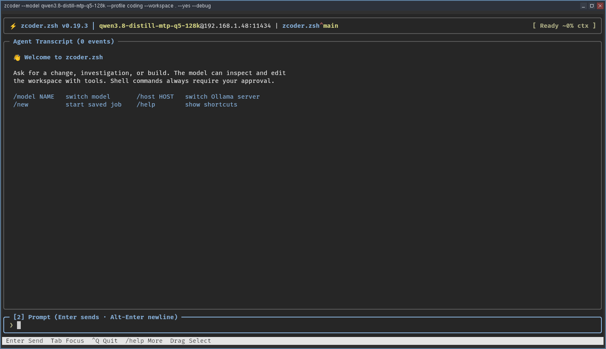
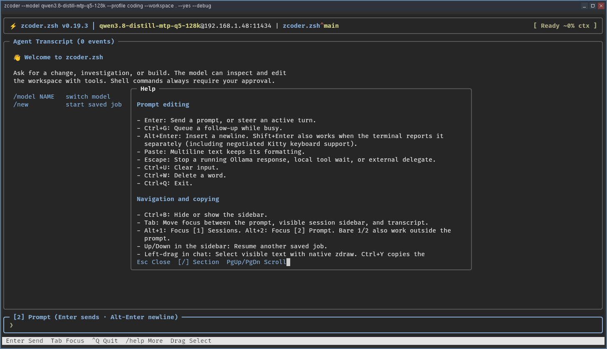
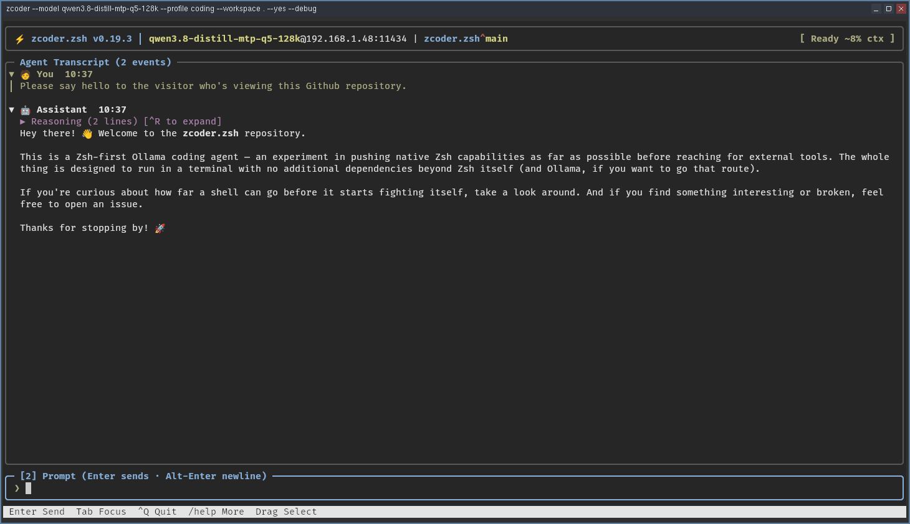

# zcoder.zsh

**A capable coding agent for Ollama, built almost entirely in Zsh.**

zcoder works inside a directory you choose. It can explore a project, read and
edit files, apply patches, run tests, and keep working through multi-step tasks
until the job is complete. You get a focused terminal interface, local model
execution, and a clear approval prompt before any shell command runs.







It is deliberately small and inspectable. Application logic—including HTTP,
JSON, session storage, tool dispatch, and the interface—uses native Zsh modules.
External tools are used where they are the actual capability: `rg` for search,
`git` or `patch` for patches, and your shell for approved commands.

## Why try it?

- **Local by default.** Use any Ollama model with tool-calling support.
- **Useful on real projects.** Search, edit, patch, test, and iterate from one conversation.
- **Steer work as it runs.** Send corrections at the next tool boundary or queue a follow-up for later.
- **Select just the chat.** With the native UI, drag to highlight text inside the chat pane and press Ctrl+Y to copy it.
- **Run a command with `!`.** See its output in chat, then ask about it when you are ready. The agent waits for your next request.
- **Bounded and reviewable.** File tools stay inside the workspace; shell commands ask first.
- **Project-aware.** Hierarchical `AGENTS.md`, Agent Skills, and stdio MCP tools are built in.
- **Context-frugal with Bit Lantern.** Find code through a local structural index instead of spending a small model's context window on grep output and whole-file reads.
- **Warm on arrival.** The interactive TUI loads the model and stable project context while you type.
- **Coordinates local work.** Running instances on the same machine can discover each other and hand off tasks through a private Unix socket relay.
- **Available across your network.** Run the agent beside a remote workspace and control it from your local TUI.
- **Available to ACP clients.** Run zcoder as an External Agent locally or bridge ACP to a remote zcoder server.
- **No application framework.** Just Zsh 5.8+, its standard modules, and a handful of purpose-specific tools.

## Try it

You need Zsh 5.8 or newer, a running Ollama server, a tool-capable model, and
`ripgrep`. Install `git` or `patch` if you want the agent to apply changes.

```sh
ollama pull qwen3-coder
git clone https://github.com/ZaguanLabs/zcoder.zsh.git
cd zcoder.zsh
make
./zcoder.zsh --model qwen3-coder --workspace /path/to/project
```

Then ask for a concrete outcome:

```text
Find the cause of the failing tests, make the smallest safe fix, and verify it.
```

`make` initializes the pure-Zsh zjson dependency and prepares a private Zsh
runtime with the pinned zdraw and zmdown modules for the enhanced interface and
Markdown rendering. It needs a C toolchain,
Autoconf, ncurses development headers and download tools; see
[build requirements](docs/getting-started.md#enhanced-curses-module). It requires
no administrator access and leaves your system shell unchanged.

To use the stock renderer, run `make compile` and launch the script. This
initializes zjson and compiles Zsh libraries without building native modules.

Prefer a non-interactive run? Use `--prompt`:

```sh
./zcoder.zsh --model qwen3-coder --workspace . \
  --prompt "Inspect this project and explain how it is organized"
```

## Go further on small context windows with Bit Lantern

Local models usually run with far smaller context windows than hosted ones.
Every search result and whole-file read the agent uses to *find* code is context
it can no longer spend on *changing* code. When the window fills, zcoder has to
compact the conversation, and smaller models lose the thread sooner.

[Bit Lantern](https://bit-lantern.dev/) moves discovery out of the context
window. It is a local, read-only MCP server that keeps a persistent structural
index of your project and answers with the right file and the exact source
range in one tool call. Indexing and queries stay on your machine, just like
your Ollama models.

zcoder speaks MCP natively, so adding it takes one command:

```sh
./zcoder.zsh mcp add bitlantern -- "$HOME/.local/bin/bitlantern" mcp
```

What that buys a local model:

- **Less reading to find code.** `symbol_outline` lists what a file contains
  without loading it, `symbol_search` lands on a definition's exact lines, and
  `symbol_references` replaces broad grep sweeps for callers and usages.
- **Longer runs between compactions.** A leaner history leaves room for the
  actual task, so multi-step work gets further before zcoder has to summarize,
  and less detail is lost when it does.
- **Quicker turns on modest hardware.** Fewer prompt tokens means less prompt
  evaluation for Ollama on every request.
- **Routing small models can follow.** Project-designated MCP routing in
  `AGENTS.md` takes precedence over zcoder's built-in search workflow, and the
  system prompt maps short tool names to their namespaced MCP functions.

Bit Lantern publishes reproducible benchmarks against shell-only navigation.
With Bit Lantern, Claude Code used 66.8% less total input and 55.8% less output,
and Antigravity used 49.8% less total input. Those runs used hosted models with
large windows; on a local model with a fraction of that space, savings of that
size can decide whether a task finishes cleanly or spends its time compacting.
See the [benchmarks](https://bit-lantern.dev/benchmarks) for methods, raw runs,
and the cases where shell-only won.

The Free tier includes `symbol_search`, `symbol_outline`, and
`symbol_references` with no account. See [MCP servers](docs/mcp.md) for
headless `PATH` setup and per-project configuration.

## Built for networks you control

zcoder is made for machines you already trust: your workstation, your home
lab, the build server on your LAN, and your own Ollama host. Designing for that
setting keeps it small, fast, and easy to deploy:

- **Your models, your hardware.** Prompts, source code, and tool output go to
  the Ollama host you choose. Nothing leaves your network unless you add a
  service that needs it, such as a web-search MCP server.
- **Remote workspaces with one token file.** The remote API uses lightweight,
  token-authenticated HTTP, so there are no certificates to issue or renew.
- **Unattended when you want it.** Start a coding server with `--yes` and it
  works through long tasks without waiting for you.

The guardrails that matter on any network are always on. File tools stay
inside the workspace, and shell commands ask first unless you chose otherwise.
A project's `.mcp.json` starts nothing until you approve it, and the sysadmin
profile approves every command individually. To reach a workspace from outside
your network, use an SSH tunnel or a VPN. See
[Safety and permissions](docs/safety.md#deployment-model).

## Remote workspaces

zcoder can also run headlessly on the machine that owns the model and workspace.
The local instance becomes a thin client: prompts travel to the server, every
tool runs remotely, and command approvals return to your local terminal.

For browser access, [zcoder-web](https://github.com/ZaguanLabs/zcoder-web) is a
lightweight web interface that connects to one or more zcoder.zsh servers.
Manage remote sessions, send prompts, and approve commands from your desktop
or phone.

See the [remote-agent guide](docs/remote.md) for setup and security guidance.

## ACP clients

Run `./zcoder.zsh --acp` to expose zcoder as an Agent Client Protocol v1
agent over stdio. It can use the local runtime directly or connect through the
existing authenticated remote API with `--acp --connect HOST`.

See the [ACP guide](docs/acp.md) for client configuration, supported
capabilities, and remote deployment.

## Documentation

- [Getting started](docs/getting-started.md)
- [Interface and sessions](docs/interface.md)
- [Steering and queued follow-ups](docs/queued-input.md)
- [User shell commands](docs/user-shell-commands.md)
- [Remote-agent server](docs/remote.md)
- [Agent Client Protocol](docs/acp.md)
- [Safety and permissions](docs/safety.md)
- [Project guidance and Agent Skills](docs/project-guidance.md)
- [MCP servers](docs/mcp.md)
- [Configuration and context management](docs/configuration.md)
- [Inter-agent communication](docs/inter-agent-communication.md)
- [Architecture](docs/architecture.md)
- [Development](docs/development.md)

Start with the [documentation index](docs/README.md) if you are not sure where
to look.

## License

[Apache 2.0](LICENSE)
